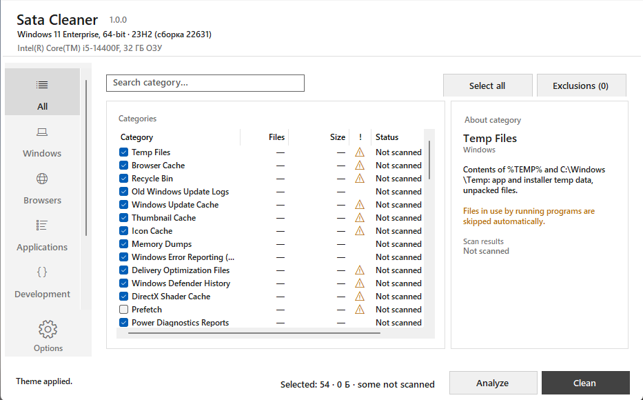

  
 

  
  
  
  
  
  

# Sata Cleaner
## Safe Windows cleanup: temp files, caches, logs and dumps. 60+ categories, sensitive ones disabled by default. 32/64-bit, Windows 7–11.

#### Screenshot

  

#### About Sata Cleaner frees up disk space by removing data that Windows and applications recreate automatically: temporary files, browser and app caches, logs, memory dumps and error reports.

Written in C#. The source code is proprietary; only the compiled executable is distributed.

### Features
50+ independent cleanup categories — each can be enabled or disabled individually.

Safe by default — categories whose removal could lead to loss of user data are disabled initially.

Warnings — potentially sensitive categories display a description of the consequences.

Recoverable — most removed data is recreated by the system or applications on the next launch.

- Cleanup categories
- System temporary files
- Windows temporary files

- Recycle Bin — on all drives

- Windows Update cache (with update services stopped)

- Delivery Optimization files — Windows Update cache for sharing updates with other PCs on the network

- Windows Cryptographic Services cache

- Logs and reports
- Old Windows Update logs

- DISM, CBS and MoSetup logs

- Windows Setup logs

- General Windows logs — old files (active logs untouched)

- Archived event logs (active logs untouched)

- Windows Error Reporting reports

- Power Efficiency Diagnostics reports

Windows Defender history — detection and scan logs

- Memory dumps
Memory dump files. Created on system/driver crashes, useless to the average user, safe to delete.

- Windows caches
Thumbnail Cache — the system will recreate it as needed

- Icon Cache — Explorer or system restart required after cleanup

- Font cache

- Language pack cache

- Lock screen cache

- Device Manager cache and logs

- Event Viewer cache

Orphaned Windows Installer setup files — a safe PatchCleaner alternative

- DirectX Shader Cache

- Prefetch folder. Disabled by default. ⚠️ May slow down the first launch of applications after cleanup until Windows rebuilds the cache

- Browsers
Browser caches — Chrome, Edge, Firefox, Brave, Opera, Yandex (with browsers closed)

- Hidden thumbnail cache files in user folders

#### Applications
- BlueStacks — Android emulator cache and temporary files

- Cheat Engine — temporary files and logs

- Inno Setup — installer temporary files

- Microsoft NuGet Package Cache

- Microsoft Visual Studio — IDE cache, logs and temporary files

- Chromium Embedded Framework — cache of CEF-based applications

- Discord — cache (without login sessions)

- Oracle Java — cache and temporary files

- FL Studio — cache and temporary files

- OBS Studio — cache and logs

- 7-Zip — extraction temporary files

- WinRAR — extraction temporary files

- AnyDesk — cache and logs

- CrashRpt — crash reports

- Everything — search index cache

- IDLE (Python) — temporary files

- Python — __pycache__ and temporary files

- Intel — driver and utility cache

- LockHunter — temporary files

- Oracle VirtualBox — virtual machine logs and temporary files

- Adobe Crash Reporter — crash reports

- Adobe Creative Cloud — application cache

- Adobe Flash Player — cache (if still in use)

#### NVIDIA
- NVIDIA App — application cache

- NVIDIA Control Panel — settings cache

- NVIDIA FrameView — logs and cache

- NVIDIA Overlay — overlay cache
 
- NVIDIA Shader Cache — shader cache

- NVIDIA Graphics Drivers — driver installation temporary files. Disabled by default

- NVIDIA Update Files — downloaded update files. Disabled by default

Categories with warnings (disabled by default)
#### Microsoft Visual Studio Installation Packages — downloaded setup packages

- Microsoft Visual Studio Backups — autosave backups

- Notepad++ Backups & Unsaved Files — ⚠️ backups and unsaved files, possible data loss

### System requirements
Windows 7 / 8 / 8.1 / 10 / 11

### 32-bit or 64-bit
Administrator rights (for stopping services and cleaning system folders)

# Download
## The latest version is available on the [**`Releases page`**](https://github.com/vyrexo/Sata-Cleaner/releases/tag/1.1.0).

#### Usage recommendations
Before the first run, close browsers and applications whose caches you plan to clean.

Enable categories disabled by default consciously — they affect backups, unsaved files or setup packages.

Categories marked ⚠️ require reading the warning before enabling.

After cleaning the icon cache, restart Explorer or the system.

Behavior verification
All file operations are listed in the category list above. You can verify the program's behavior using a file system monitor (e.g., Process Monitor by Sysinternals).

### License
All rights reserved. The source code is proprietary. The executable is provided for free use. Copying, modification and distribution of the source code are prohibited.

Sata Cleaner — safe Windows cleanup: temp files, caches, logs and dumps. 60+ categories, sensitive ones disabled by default. 32/64-bit, Windows 7–11.

